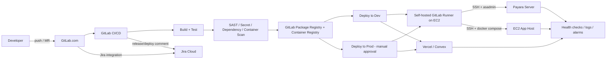
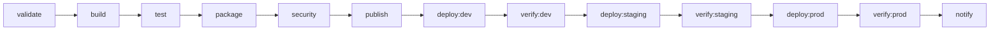

# CI/CD Assessment and Target Design

**Platform:** SVI KYC / RBAC / eKYC  
**Repositories reviewed:** local working copies under `the local workspace`  
**Review date:** 2026-10-19  
**Primary source control:** GitLab.com, group `svi.ph/kyc-digital-verification`  
**Primary runtime:** Amazon EC2, Payara Server, Docker/Compose, Vercel

---

## 1. Purpose

This document answers four questions:

1. What does the current codebase and CI setup actually do?
2. What can be automated safely?
3. What should the target pipeline and deployment architecture look like?
4. What must be fixed before automation is trustworthy?

It is intentionally opinionated. The goal is a design the team can implement in phases, not a catalogue of every possible tool.

---

## 2. What the codebase tells us

### 2.1 Application inventory

| Repository | Stack | Build output | Runtime / deploy target | Current CI | Tests present |
|---|---|---|---|---|---|
| `svi-authentication-java-kyc` | Java 8, Jersey, Maven WAR | `target/*.war` | Payara, context `/auth-services` | Tag-only S3 upload | 0 |
| `kyc-api` | Java 8 source level, Jersey, Maven WAR | `target/*.war` | Payara, context `/gen-kyc-api` | Tag-only S3 upload | 0 |
| `svi-authentication-springboot-kyc` | Spring Boot 4.0.5, Java 25, Maven | executable JAR | `java -jar` or Docker, port 8081, context `/spring/auth-services` | MR verify, tests skipped | 51 test classes |
| `svi-kyc-api-springboot-kyc` | Spring Boot 4.0.5, Java 25, Maven | executable JAR | `java -jar` or Docker, context `/gen-kyc-api-sb` | MR verify, tests skipped | 3 test classes |
| `svi-authenticationportal-react-kyc` | React 19 + Vite + TypeScript | WAR via `scripts/build-war.mjs` | Payara, context `/portal` | MR/default build WAR | 4 test files |
| `svi-sso-admin-panel-javascript-kyc` | React 19 + Vite + JavaScript | WAR via `scripts/build-war.mjs` | Payara, context `/sso_admin` | MR/default build WAR | 18 test files + Playwright |
| `svi-personviewer-react-kyc` | React 19 + Vite + TypeScript | WAR via `scripts/build-war.mjs` | Payara, context `/viewer` and `/dev/viewer` | None | 0 |
| `svi-transactionviewer-react-kyc` | React 19 + Vite + TypeScript | WAR via `scripts/build-war.mjs` | Payara, context `/lgu-records-viewer-ui` and `/dev/lgu-records-viewer-ui` | None | 0 |
| `generic-kyc-owa` | Angular 16 + Karma | WAR via `builder/build-war.sh` | Payara, context depends on `EKYC_OWA_CONTEXT_ROOT` | None | 43 spec files |
| `1bataan-crosscheck-tool` | Java 25, Drools, Maven shaded JAR | executable JAR | EC2 batch job / systemd timer | None | JUnit 5 present |
| `svi-digicash` | Node 20 + Express | Docker image | EC2 Docker Compose, port 3000 | None | Node test scripts |
| `bataan-crosscheck-engine` | Python FastAPI + static UI | Python app | Optional Docker/VM | None | None |
| `face-id-matcher` | Python FastAPI + Node tooling | Docker image | Render/Docker | None | None |
| `openbiometrics` | Python/FastAPI workspace | Docker image | Render | None | Some tests |
| `cps-202` | Next.js | Vercel build | Vercel | None | None |
| `finance-tracker` | Next.js + Convex | Vercel + Convex | Vercel | None | None |
| `knowledge-center` | Next.js + Convex | Vercel + Convex | Vercel | None | None |
| `svi-captivate-directory` | Vite + React | static `dist/` | Vercel or static host | None | lint/typecheck only |
| `svi-pusopay-demo` | Node/Express demo | Node app | Demo only | None | Node tests |

**Primary production scope for this report:** the first eleven rows. The GitHub-hosted demos are addressed in section 2.7.

### 2.2 Existing GitLab pipelines

Only six repositories have a `.gitlab-ci.yml`:

```
kyc-api
svi-authentication-java-kyc
svi-authentication-springboot-kyc
svi-authenticationportal-react-kyc
svi-kyc-api-springboot-kyc
svi-sso-admin-panel-javascript-kyc
```

They fall into two generations:

**Generation 1 - legacy tag-to-S3 jobs (`kyc-api`, `svi-authentication-java-kyc`)**

- Trigger only on git tags.
- Use `banst/awscli` as the job image but call `mvn` inside it. That image is an AWS CLI image, not a Maven image; unless the runner has a shell override, the build will fail with `mvn: not found`.
- Hardcode AWS credentials directly in the YAML.
- Comment out test and compile stages.
- Upload `target/*.war` to S3 under `snapshot/<project>/<version>/`.
- Run a `cleanup_job` that deletes `$CI_PROJECT_DIR/*`. This is risky and unnecessary in an ephemeral container.
- Do not rename the artifact with the commit SHA, so two builds of the same version overwrite each other.

**Generation 2 - verify-only jobs (`svi-authentication-springboot-kyc`, `svi-kyc-api-springboot-kyc`)**

- Use `maven:3.9-eclipse-temurin-25`.
- Run only on merge request events.
- Run `mvn clean verify -DskipTests`.
- Do not publish a JAR, build a Docker image, or deploy.
- The `-DskipTests` flag is the biggest missed opportunity: the auth service has 51 test classes.

**Frontend WAR jobs (`svi-authenticationportal-react-kyc`, `svi-sso-admin-panel-javascript-kyc`)**

- Use `node:18` and install `default-jdk-headless` so the WAR packager can call `jar`.
- Run `npm ci` and `npm run build-prod`.
- Publish `dist-war/*.war` as a pipeline artifact for 7 days.
- Do not run unit tests or Playwright, do not publish to a registry, and do not deploy.

### 2.3 How deployment appears to happen today

- **Payara apps:** a WAR/JAR is uploaded through the Payara Admin Console (usually port `4848`) or copied to the server and deployed with `asadmin`. The team describes this as "uploading the jar to the Payara service thing". In practice the deployable is a **WAR**, not a Spring Boot JAR.
- **Spring Boot services:** executable JARs are started with `java -jar`, likely as a service or background process. The auth service reads external config from `/home/auth_system/auth_ws/config/config_files_properties/...`, which suggests a fixed server layout rather than a container.
- **DigiCash:** `DEPLOY.md` documents `scp` of the project folder to an EC2 host and `docker compose build --no-cache && docker compose up -d` on the server.
- **Frontends:** React/Angular apps are built into WARs locally and uploaded to Payara, with separate dev context roots (`/dev/viewer`, `/dev/lgu-records-viewer-ui`) baked into the dev environment files.

There is no deployment job in any GitLab pipeline. There are no GitLab environments, no deployment approvals, no deployment history, and no rollback job.

### 2.4 Branch, tag, and version observations

Current checked-out branches across the primary repos are inconsistent:

```
development, Development, master,
feature/merging-branch, feature/initial-migration,
feature/merging-branch-pulled, feature/merging-branch-security
```

Observed tags:

```
svi-authentication-java-kyc:        v1.0.0-FINAL
kyc-api:                            navotas-uat-v2, v2.4.0-b1, v3.0.0-FINAL
svi-authentication-springboot-kyc:  v3.1.0, v3.1.0-FINAL, v3.2.0
svi-kyc-api-springboot-kyc:         v4.0.0, v4.1.0, v4.2.0
svi-authenticationportal-react-kyc: v2.1.0, v2.2.0, v2.3.0
svi-sso-admin-panel-javascript-kyc: v2.1.0, v2.2.0, v2.3.0
svi-personviewer-react-kyc:         v1.0.0, v1.1.0
```

Version drift is real:

- `svi-authentication-springboot-kyc/pom.xml` says `v2.1.0`, while the repo has tags up to `v3.2.0`.
- `svi-kyc-api-springboot-kyc/pom.xml` says `v2.0.0`, while the repo has tags up to `v4.2.0`.
- `svi-personviewer-react-kyc/scripts/build-war.mjs` hardcodes `VERSION = 'v1.0.0'` even though tags `v1.1.0` exist.
- `svi-transactionviewer-react-kyc/scripts/build-war.mjs` hardcodes `VERSION = 'v1.0.0'`.
- `svi-sso-admin-panel-javascript-kyc/scripts/build-war.mjs` hardcodes `VERSION = 'v1.0.0'`.
- `svi-authenticationportal-react-kyc/scripts/build-war.mjs` hardcodes `VERSION = 'v3.0.0'`.
- `generic-kyc-owa/builder/build-war.sh` hardcodes `VERSION="2.4.0-b1"` and `APP="onboarding"`.

This means the artifact on the server often cannot be matched to a git tag or commit.

### 2.5 Environment configuration observations

- The "prod" environment files for the React apps still point at `https://kyc.dev.svi.cloud` (for example `svi-authenticationportal-react-kyc/src/environments/environment.prod.ts` and `svi-sso-admin-panel-javascript-kyc/src/environments/environment.prod.js`). The suffix says prod; the target is dev.
- Dev builds use different context roots (`/dev/viewer`, `/dev/lgu-records-viewer-ui`, `/dev/owa`) while prod builds use `/viewer`, `/lgu-records-viewer-ui`, `/portal`, `/sso_admin`. This is a workable way to host both on one Payara domain, but it must be explicit in the pipeline.
- `generic-kyc-owa/src/WEB-INF/glassfish-web.xml` contains `${ENV=EKYC_OWA_CONTEXT_ROOT}`. The build script does not replace it, so the placeholder can be deployed as-is unless the deploy command sets the context root.
- `svi-kyc-api-springboot-kyc` does not set `server.port`, so it defaults to `8080`. Payara also defaults to `8080`. If both run on the same host, this is a port conflict. Set an explicit port (for example `8082`) or containerize and map a different host port.
- `svi-authentication-springboot-kyc` sets `server.port=8081` and reads nine external config files from `/home/auth_system/auth_ws/config/config_files_properties/`. This path must be mounted or provided as environment variables in Docker.

### 2.6 Security findings (critical)

The review found credential material in repository files. Values are deliberately omitted from this report.

**Committed CI credentials**

- `svi-authentication-java-kyc/.gitlab-ci.yml`
- `kyc-api/.gitlab-ci.yml`

Both contain hardcoded AWS access key / secret key values. Treat them as compromised and rotate them immediately. Also rotate any IAM user or access key that was created from them.

**Committed application secret files**

Files tracked by git that contain secret-like properties (passwords, client secrets, keys) include:

```
svi-authentication-java-kyc/WebContent/WEB-INF/configurations/GeneralConfig.ini
svi-authentication-java-kyc/WebContent/WEB-INF/configurations/KeycloakAdminConfig.ini
svi-authentication-java-kyc/WebContent/WEB-INF/configurations/KeycloakEndpointsConfig.ini
svi-authentication-java-kyc/WebContent/WEB-INF/configurations/KeycloakGenericConfig.ini
kyc-api/WebContent/WEB-INF/configurations/config/credentials.ini
kyc-api/WebContent/WEB-INF/configurations/config/config.ini
kyc-api/WebContent/WEB-INF/configurations/config/config_demo.ini
kyc-api/WebContent/WEB-INF/configurations/config/config_navotas_uat.ini
kyc-api/WebContent/WEB-INF/configurations/config/megaMatcherConfig.ini
kyc-api/WebContent/WEB-INF/configurations/config/svi_auth_config.ini
svi-authentication-springboot-kyc/config/keycloak-admin-config-local.properties
svi-authentication-springboot-kyc/config/keycloak-endpoints-config-local.properties
svi-authentication-springboot-kyc/config/keycloak-generic-config-local.properties
svi-authentication-springboot-kyc/config/email-sender-config-local.properties
svi-authentication-springboot-kyc/config/init-config-local.properties
svi-kyc-api-springboot-kyc/src/main/resources/config/config.properties
svi-kyc-api-springboot-kyc/src/main/resources/config/svi_auth_config.properties
svi-sso-admin-panel-javascript-kyc/.env.cloud
svi-sso-admin-panel-javascript-kyc/.env.localdev
```

Some of these files may be intended as local defaults rather than production values, but they are still in git history. Review each one, replace real values with placeholders, and rotate anything that was live.

**Other exposure in the workspace**

- A security summary markdown at the workspace root embeds a Payara client secret. Move it to a secret store and scrub the document.
- `svi-digicash/config.env` exists locally and is untracked, but `DEPLOY.md` shows secrets being placed in `.env`/`config.env` on the server. Use SSM/Secrets Manager or GitLab protected variables instead of hand-edited files.
- `.gitconfig` contains a personal email address; not a secret, but review whether personal identities should be used for company commits.

**Required response**

1. Rotate AWS keys, Payara admin credentials, Keycloak client secrets, database passwords, DigiCash keys, and any token found in those files.
2. Remove the values from the files and from git history (BFG Repo-Cleaner or `git filter-repo` after coordination).
3. Add GitLab Secret Detection with a historic scan.
4. Store runtime secrets in GitLab CI/CD variables (masked + protected) or AWS Secrets Manager / SSM Parameter Store.
5. Do not print secrets in CI logs; use `--password-stdin` / password files / file-type variables.

### 2.7 Other repositories

These are GitHub-hosted or demo-oriented and are not on the company GitLab:

| Repo | Host | Recommended handling |
|---|---|---|
| `cps-202` | GitHub `kevzo8/cps-202` | Next.js demo; Vercel Git integration is enough |
| `cps-272` | GitHub `kevzo8/cps-272` | Static HTML deck; Vercel static deploy, no pipeline needed |
| `finance-tracker` | GitHub `kevzo8/finance-tracker` | Next.js + Convex; Vercel + Convex deploy keys |
| `knowledge-center` | GitHub `kevzo8/knowledge-center` | Next.js + Convex; same as above |
| `svi-captivate-directory` | GitHub `GiovanniL30/svi-captivate-directory` | Vite static; Vercel or GitHub Pages |
| `svi-digicash` | GitHub `kevzo8/svi-digicash` | If production, mirror to GitLab and use the Docker template |
| `svi-pusopay-demo` | GitHub `kevzo8/pusopay` | Demo; no production pipeline required |
| `face-id-matcher` | GitHub `kevzo8/face-id-matcher` | Docker/Render; add a simple build-and-push workflow if it becomes a service |
| `openbiometrics` | GitHub `openbm/openbiometrics` | Upstream project; do not fork CI unless you maintain it |
| `bataan-crosscheck-engine` | GitLab remote, Python sample | Low priority; containerize only if it becomes a service |
| `1bataan-crosscheck-tool` | GitHub `kevzo8/1bataan-crosscheck-tool` | Batch JAR; use the batch pipeline pattern |

If any GitHub repo is part of the production KYC flow, mirror it into the company GitLab group and apply the same pipeline, secrets, and Jira standards. Two source-control platforms double the audit burden.

---

## 3. Findings summary

### 3.1 Build and test

| Finding | Impact | Recommendation |
|---|---|---|
| Spring Boot pipeline uses `-DskipTests` | 51 auth tests and 3 KYC API tests never run | Remove the flag; publish JUnit reports |
| Frontend pipelines do not run tests | 18 SSO admin tests, 4 portal tests, 43 Angular specs ignored | Add `test` jobs; make them required for merge |
| Person/Transaction Viewer have no tests | No regression signal | Add Vitest smoke tests and Playwright happy-path E2E |
| Generic OWA has no pipeline | Manual Angular build and manual WAR packaging | Add Angular WAR template |
| Legacy CI uses wrong image | Build may fail or depend on runner extras | Use Maven images; pin versions |
| Build caches are partial | Slow Maven/npm jobs | Cache `.m2/repository` and npm cache per branch |
| Build output is not immutable | Same version can overwrite different code | Add version + short SHA to artifact name |

### 3.2 Deployment

| Finding | Impact | Recommendation |
|---|---|---|
| No deploy jobs | Every release is manual | Add environment-scoped deploy jobs |
| No deployment history | Cannot audit who deployed what | Use GitLab environments + deployment log on server |
| No health checks | A bad deploy looks successful | Add HTTP smoke tests and fail the job |
| No rollback | Recovery depends on memory and manual uploads | Keep last N WARs/images; add rollback job/script |
| Payara Admin Console uploads | Error-prone, no version trail | Use `asadmin deploy` from CI |
| `docker compose build` on server | Server compiles code; drift from CI | Build the image in CI, pull it on the server |
| Manual `.env` edits | Secret sprawl and configuration drift | Render env from CI variables or SSM |

### 3.3 Configuration and versioning

| Finding | Impact | Recommendation |
|---|---|---|
| "prod" configs point at dev host | Deploying "prod" may hit the wrong backend | Introduce explicit dev/staging/prod config files and hostnames |
| Hardcoded WAR versions | Artifact does not match tag | Inject `APP_VERSION` from CI |
| POM versions behind tags | Release traceability is broken | Align POM version with tag or use CI-friendly `${revision}` |
| `EKYC_OWA_CONTEXT_ROOT` placeholder | Wrong context root possible | Patch descriptor at build time or pass `--contextroot` |
| Spring Boot port default `8080` | Conflict with Payara | Set `server.port=8082` or container port mapping |
| External config path `/home/auth_system/...` | Container deployment fails | Mount config or override `*_CONFIG_FILE` env vars |

### 3.4 Operations

| Finding | Impact | Recommendation |
|---|---|---|
| No monitoring/health endpoints | Outages discovered by users | Add Spring Boot Actuator, uptime checks, CloudWatch alarms |
| No notifications | Team finds out late | Slack/Teams/email on pipeline and deploy result |
| No runbooks | Recovery depends on individuals | Document deploy/rollback/restore in the repo |
| No change calendar | Deployments collide with releases | Use Jira fix versions and deployment windows |

---

## 4. Target architecture

### 4.1 High-level design



### 4.2 Tool decision

| Requirement | GitLab CI/CD | Jenkins | GitHub Actions | Codemagic |
|---|---|---|---|---|
| Already used by company repos | Yes | No | No | No |
| Built-in MR pipelines | Yes | Plugin | Yes | Partial |
| Container/package registry | Yes | Plugin | Yes (GHCR) | No |
| Self-hosted runner on EC2 | Yes | Yes | Yes | No |
| Security scanners | Built-in | Plugins | Marketplace | Limited |
| Jira integration | Built-in | Plugin | Marketplace | No |
| Operational overhead | Low | High | Medium | Low |
| Fit for Java/Payara/EC2 | Strong | Strong | Strong | Poor |

**Decision:** GitLab CI/CD, with one self-hosted runner on EC2 for deployment jobs and GitLab.com shared runners for build/test. Revisit Jenkins only if a future requirement cannot be met by GitLab (for example, complex on-prem orchestration with existing Jenkins shared libraries).

### 4.3 Environments

| Environment | Branch/tag | Trigger | Approval | Purpose |
|---|---|---|---|---|
| MR/preview | Any feature branch | Merge request event | None | Lint, test, build, scan only |
| Dev | `development` | Push | None | Auto-deploy, integration testing |
| Staging (optional) | `master`/`main` | Push or manual | QA lead | Pre-production verification |
| Production | `v*` tag | Tag | Release manager + tech lead | Customer traffic |
| Rollback | Manual job | Any time | Release manager | Re-deploy previous artifact |

Keep the current `development`/`master` names to avoid disrupting the team. Normalize case: pick `development` and `master` (lowercase) and rename or protect the uppercase variants.

### 4.4 Runner design

**Recommended:** a dedicated small EC2 runner (t3.small/t3.medium) with the Docker executor, plus network access to the Payara host and app host.

| Runner tag | Executor | Used for |
|---|---|---|
| `gitlab-shared` | GitLab.com shared | Build/test/scan jobs |
| `ec2-docker` | Docker (privileged, dedicated host) | Docker image builds |
| `ec2-deploy` | Docker or shell | SSH deploy jobs (Payara and Compose) |

Why a separate runner:

- Deployment SSH keys and registry tokens live only on the runner, not on shared SaaS runners.
- The runner can reach private EC2 addresses.
- The runner can be patched, rotated, and audited independently.
- Build jobs can use shared runners; only deploy jobs need the self-hosted runner.

If the team insists on one server, run the runner on the dev EC2 host but isolate it with a dedicated `gitlab-runner` user and Docker network. Do not run it on the production Payara host.

### 4.5 Artifact strategy

| Artifact | Store | Naming | Retention |
|---|---|---|---|
| WAR | GitLab Package Registry (generic) + optional S3 archive | `<app>-<version>-<short-sha>.war` | 90 days in registry; last 5 on server |
| Spring Boot JAR | GitLab Package Registry | `<app>-<version>-<short-sha>.jar` | 90 days |
| Docker image | GitLab Container Registry | `registry.gitlab.com/<group>/<project>:<short-sha>` and `:<version>` | Keep last 20 tags; prune old |
| Test reports | GitLab job artifacts | JUnit XML / coverage | 30 days |
| Deployment record | Server log + GitLab environment | timestamp, app, version, SHA, pipeline URL, operator | 1 year |

Do not rely on a mutable `latest` tag for production. Use the commit SHA or version tag. `latest` may exist for convenience, but production must pin an immutable tag.

### 4.6 Secrets management

| Secret | Where it should live |
|---|---|
| Payara admin password | `/etc/payara/passwordfile` on the Payara host, `600`, owned by the Payara user |
| SSH private keys | GitLab file-type variable, protected; public key on the target host |
| Registry credentials | GitLab built-in `CI_REGISTRY_USER`/`CI_REGISTRY_PASSWORD` for CI; read-only deploy token on EC2 |
| Spring Boot DB/Keycloak configs | AWS Secrets Manager or SSM Parameter Store; rendered to `/opt/svi/<app>/config` at deploy time |
| DigiCash keys | AWS Secrets Manager or SSM; never in `config.env` on disk if avoidable |
| Vercel/Convex tokens | GitLab masked/protected variables or Vercel project env vars |
| Jira API token | GitLab masked/protected variable |
| AWS access for CI | Prefer GitLab Package/Container Registry so no AWS key is needed; otherwise OIDC role assumption, not static keys |

Never put secrets in `.gitlab-ci.yml`, Dockerfiles, Compose files, or frontend environment files. Remember that anything baked into a frontend WAR is public.

---

## 5. Target pipeline design

### 5.1 Standard stages



| Stage | Jobs | Runs on | Blocks merge/deploy |
|---|---|---|---|
| `validate` | Branch/tag format, commit message, Jira key check, YAML lint | MR, branch, tag | Yes |
| `build` | Compile, `npm ci`, `ng build` | MR, branch, tag | Yes |
| `test` | Unit tests, coverage, typecheck, lint | MR, branch, tag | Yes |
| `package` | WAR/JAR/docker image, version metadata | Branch, tag | Yes |
| `security` | Secret Detection, SAST, dependency scan, container scan | MR, branch, tag | Yes for critical/high |
| `publish` | Package Registry / Container Registry | Branch, tag | Yes |
| `deploy:dev` | Deploy + smoke test | `development` | Yes |
| `deploy:staging` | Deploy + smoke test | `master`/manual | Yes |
| `deploy:prod` | Deploy + smoke test | `v*` tag/manual | Yes |
| `notify` | Slack/Teams/Jira | After deploy | No |

### 5.2 Trigger rules

Use one consistent `workflow` block:

```yaml
workflow:
  rules:
    - if: '$CI_PIPELINE_SOURCE == "merge_request_event"'
    - if: '$CI_COMMIT_BRANCH && $CI_OPEN_MERGE_REQUESTS'
      when: never
    - if: '$CI_COMMIT_BRANCH'
    - if: '$CI_COMMIT_TAG'
```

Then scope deploy jobs:

```yaml
deploy:dev:
  rules:
    - if: '$CI_COMMIT_BRANCH == "development"'

deploy:prod:
  rules:
    - if: '$CI_COMMIT_TAG =~ /^v\d+\.\d+\.\d+([-.][0-9A-Za-z.]+)?$/'
      when: manual
```

### 5.3 Pipeline per application type

#### A. Legacy Maven WAR -> Payara

```
validate -> mvn package -> mvn test -> rename WAR -> secret scan -> publish -> deploy:dev -> smoke -> deploy:prod -> smoke
```

- Image: `maven:3.9-eclipse-temurin-8`.
- Cache `.m2/repository` keyed by branch.
- Build with `mvn --batch-mode --no-transfer-progress clean package`.
- Run `mvn test` even if there are zero tests; it keeps the stage honest.
- Rename to `<app>-<version>-<short-sha>.war`.
- Publish to GitLab Package Registry (generic package).
- Deploy via SSH to the Payara host; run `asadmin deploy` + health check + rollback.
- Template: `templates/gitlab-ci-maven-war-payara.yml`.

#### B. React/Vite WAR -> Payara

```
validate -> npm ci -> lint/typecheck -> test -> build-dev or build-prod -> WAR -> secret scan -> publish -> deploy:dev -> smoke -> deploy:prod
```

- Image: `node:20` plus `default-jdk-headless` for `jar`.
- `npm ci` with cache.
- `npm run lint` and `npm run typecheck` if defined.
- `npm run test:run` (or the repo's CI test script); do not use watch mode.
- `npm run build-dev` on `development`, `npm run build-prod` on tags.
- Artifact: `dist-war/*.war`.
- Template: `templates/gitlab-ci-vite-war-payara.yml`.

#### C. Angular -> WAR -> Payara

```
validate -> npm ci -> ng test --watch=false --browsers=ChromeHeadless -> ng build --configuration production -> jar -cvf -> publish -> deploy
```

- Use a Node image with Chrome/Chromium for Karma, or a dedicated `trion/ng-cli-karma` image.
- Patch `glassfish-web.xml` context root in the build (or pass `--contextroot` at deploy).
- Replace the hardcoded version in `build-war.sh` with `APP_VERSION`.
- Template: `templates/gitlab-ci-angular-war-payara.yml`.

#### D. Spring Boot JAR -> Docker -> EC2

```
validate -> mvn verify (tests ON) -> package JAR -> docker build -> container scan -> push -> deploy:dev (compose pull/up) -> health -> deploy:prod (manual)
```

- Image: `maven:3.9-eclipse-temurin-25` for build/test.
- Run `mvn verify` without `-DskipTests`; publish surefire/JUnit reports.
- Build image in CI, push to GitLab Container Registry.
- Deploy by SSH to EC2: update `.env` with the new image tag, `docker compose pull`, `docker compose up -d`, health check, rollback to previous tag on failure.
- Mount external config under `/opt/svi/<app>/config` and set `*_CONFIG_FILE` environment variables.
- Template: `templates/gitlab-ci-springboot-docker.yml`, `templates/Dockerfile.springboot`, `templates/docker-compose.app.yml`.

#### E. Node/Express -> Docker -> EC2

- Same as D, but `npm ci`, `npm test`, `docker build`.
- DigiCash already has a Dockerfile, health endpoint, Compose file, Nginx, and systemd unit. The main change is to build and push the image in CI and change Compose from `pull_policy: build` to `pull_policy: always` with an image reference.
- Template: `templates/gitlab-ci-node-docker.yml`.

#### F. Next.js / Convex -> Vercel

- Option 1: let Vercel's Git integration handle preview/production. This is the least effort if the repo is on GitHub or connected to GitLab.
- Option 2: use Vercel CLI in GitLab CI for a single audit trail:
  - `vercel pull --environment=preview|production`
  - `vercel build`
  - `vercel deploy --prebuilt` (preview) or `--prod`
- For `finance-tracker` and `knowledge-center`, deploy Convex with `npx convex deploy` using `CONVEX_DEPLOY_KEY` before or as part of the build.
- Template: `templates/gitlab-ci-nextjs-vercel.yml`.

#### G. Batch JAR (1Bataan crosscheck)

- Build with `mvn package` (shaded JAR).
- Publish JAR to the Package Registry.
- Deploy to `/opt/batch/<app>/<version>/`.
- Update a `current` symlink atomically.
- Run with a systemd timer or cron; no web server.
- Smoke test: run `java -jar ... --help` or a dry-run against a sample input, then check exit code and output file.

### 5.4 Reusable templates

To avoid six copies of the same YAML:

1. Create a `ci-templates` repository in the GitLab group (for example `svi.ph/kyc-digital-verification/ci-templates`).
2. Put the hidden base jobs there (`.maven_cache`, `.payara_deploy`, `.compose_deploy`, `.ssh-base`).
3. Include them per repo:

```yaml
include:
  - project: 'svi.ph/kyc-digital-verification/ci-templates'
    ref: main
    file:
      - '/templates/maven-war-payara.yml'
      - '/templates/payara-deploy.yml'
```

Start with standalone templates (provided in this pack) and extract shared jobs after the first two pilots work. Do not build a complex template library before the pipelines are proven.

---

## 6. Payara deployment design

See [03-payara-war-deployment-guide.md](03-payara-war-deployment-guide.md) for the full guide. Summary:

- Payara accepts **WAR/EAR** packages, not Spring Boot executable JARs.
- Their React/Angular apps and legacy Java services are WARs.
- The `--contextroot` flag controls the URL path; `--name` controls the Payara application name.
- Deploy from CI with SSH + local `asadmin` on the Payara host to avoid exposing the admin port to the internet.
- Keep a password file on the server, not in CI.
- Back up the previous WAR and re-deploy it automatically if the health check fails.
- Verify with HTTP status codes and the Payara application list.

**Context root map:**

| Application | Payara app name (suggested) | Dev context | Prod context |
|---|---|---|---|
| Legacy auth | `auth-services` | `/auth-services` | `/auth-services` |
| Legacy KYC API | `gen-kyc-api` | `/gen-kyc-api` | `/gen-kyc-api` |
| SSO Portal | `svi-portal` | `/portal` | `/portal` |
| SSO Admin | `svi-sso-admin` | `/sso_admin` | `/sso_admin` |
| Person Viewer | `svi-person-viewer` | `/dev/viewer` | `/viewer` |
| Transaction Viewer | `svi-transaction-viewer` | `/dev/lgu-records-viewer-ui` | `/lgu-records-viewer-ui` |
| Generic OWA | `svi-owa` | `/dev/owa` | `/owa` (or `/onboarding`) |

Confirm the OWA context root with the app owner before standardizing; the current descriptor uses a placeholder.

---

## 7. EC2 and Docker deployment design

See [04-ec2-runner-and-docker-guide.md](04-ec2-runner-and-docker-guide.md) for the full guide. Summary:

- One EC2 app host can run multiple containers behind Nginx.
- Bind containers to `127.0.0.1` only; Nginx terminates TLS.
- Use a dedicated `deploy` user and `/opt/svi/<app>` directories.
- Use a read-only GitLab deploy token on the server for `docker pull`.
- Store environment files with `600` permissions and render them from SSM/GitLab variables.
- Health check after every `compose up`; roll back to the previous image tag on failure.
- Add CloudWatch alarms for CPU, memory, disk, and container restarts.

---

## 8. Security and compliance controls

| Control | Tool | Stage | Blocking |
|---|---|---|---|
| Secret detection | GitLab Secret Detection | `security` | Yes |
| SAST | GitLab SAST (Semgrep) | `security` | High/critical only |
| Dependency scanning | GitLab Dependency Scanning | `security` | High/critical only |
| Container scanning | GitLab Container Scanning | `security` | High/critical only |
| License scanning | GitLab License Scanning | `security` | Report only |
| Dependency audit | `npm audit --audit-level=high`, OWASP Dependency-Check | `test`/`security` | Report initially, then block |
| Branch protection | GitLab protected branches | N/A | Yes |
| Tag protection | GitLab protected tags `v*` | N/A | Yes |
| Deploy approval | GitLab protected environments | `deploy:prod` | Yes |
| Audit trail | GitLab environments + server deploy log | N/A | N/A |
| Secret storage | GitLab variables / AWS Secrets Manager | N/A | N/A |

Run Secret Detection on the full history once:

```yaml
secret_detection:
  variables:
    SECRET_DETECTION_HISTORIC_SCAN: "true"
```

After the historic scan is clean, remove the variable to keep pipelines fast.

---

## 9. Jira and engineering standards

See [05-jira-gitlab-standards.md](05-jira-gitlab-standards.md) for the full standard. Summary:

- Branch: `feature/<JIRA-KEY>-short-description`, `bugfix/<JIRA-KEY>-...`, `hotfix/<JIRA-KEY>-...`, `release/<version>`.
- Commit: Conventional Commits with Jira key, for example `feat(CPS-164): add tenant client-id endpoint`.
- MR title includes the Jira key; MR template includes test evidence, deployment notes, and rollback plan.
- Jira status mapping: To Do -> In Progress (branch created) -> In Review (MR opened) -> Ready for QA (deployed to dev) -> Done (merged and released).
- GitLab Jira integration links commits/MRs to issues. Use a small CI job or Jira Automation for status transitions if the integration does not transition automatically.
- Version tags `vMAJOR.MINOR.PATCH`; Jira `fixVersion` matches the tag.
- Release notes generated from Jira issues in the fix version plus merged MR titles.

---

## 10. Rollback and disaster recovery

| Layer | Rollback method | Target time |
|---|---|---|
| Payara WAR | Re-deploy previous WAR from `/opt/payara/deploy-backups/<app>/` | < 5 min |
| Spring Boot container | Set previous image tag in `.env`, `docker compose up -d` | < 5 min |
| Node container | Same as Spring Boot | < 5 min |
| Frontend WAR | Re-deploy previous WAR | < 5 min |
| Next.js/Vercel | Promote previous deployment in Vercel | < 5 min |
| Database | Restore snapshot or run backward-compatible migration | Per DB runbook |
| Payara domain | `asadmin restore-domain` from `backup-domain` | < 30 min |

Rules:

- Keep at least five previous WARs and five previous image tags.
- Never auto-rollback a database migration; design migrations to be backward-compatible (expand/contract).
- Record the rollback in the same deployment log and Jira issue.
- Test rollback once per quarter in dev.

---

## 11. Observability

| Signal | Source | Action |
|---|---|---|
| Application health | Spring Boot Actuator `/actuator/health`, Payara context root, DigiCash `/api/health` | Pipeline smoke test + uptime monitor |
| Logs | CloudWatch Logs agent, Docker logs, Payara `server.log` | Central dashboard, retention 30-90 days |
| Metrics | CloudWatch (CPU, memory, disk), Actuator Micrometer | Alarms to Slack/Teams |
| Deployment events | GitLab environments + server log | Annotate dashboards |
| Error tracking | Sentry (optional) | Alert on new error groups |

Add `spring-boot-starter-actuator` to both Spring Boot services and expose only `health,info,metrics,prometheus` on an internal port or protected path.

---

## 12. Implementation roadmap summary

The full roadmap is in [06-implementation-roadmap.md](06-implementation-roadmap.md).

| Phase | Duration | Deliverable |
|---|---|---|
| 0. Security cleanup | Week 1 | Rotated credentials, secret detection, variables configured |
| 1. Baseline CI | Weeks 1-2 | Build/test/scan/artifact for every primary repo |
| 2. Dev auto-deploy pilots | Weeks 2-4 | Payara WAR + Spring Boot Docker auto-deploy to dev |
| 3. Rollout | Weeks 4-6 | All WAR/Docker apps, smoke tests, rollback, Jira links |
| 4. Production gates | Weeks 6-8 | Tag releases, approvals, release notes, monitoring |

Effort estimate: one DevOps engineer plus repo owners for validation. The repo owners are needed mainly for build commands, test fixes, and context-root confirmation.

---

## 13. KPIs

| KPI | Definition | Target |
|---|---|---|
| Deployment frequency | Production deployments per week | 1+ per sprint |
| Lead time for change | Commit to production | < 1 day for small changes |
| Change failure rate | Deployments requiring rollback/hotfix | < 15% |
| MTTR | Time to restore service | < 30 minutes |
| Pipeline duration | MR pipeline | < 10 minutes |
| Test automation | Repos with required tests | 100% of repos with tests |
| Artifact traceability | Deployments linked to SHA/tag | 100% |
| Secret incidents | Secrets committed to repos | 0 |
| Manual deploy steps | Human steps for dev/prod | 0 dev / approval-only prod |

---

## 14. Risks and mitigations

| Risk | Likelihood | Impact | Mitigation |
|---|---|---|---|
| Secret rotation breaks running apps | Medium | High | Rotate in a maintenance window; update consumers first; keep old secret until verified |
| Git history rewrite disrupts clones | Medium | Medium | Announce freeze, coordinate re-clone, use BFG/filter-repo, keep a backup mirror |
| Payara deploy causes downtime | High (single node) | Medium | Deploy in a low-traffic window; keep rollback ready; consider a second Payara node later |
| Pipeline blocks urgent hotfix | Medium | High | Hotfix branch + fast-track approval; `when: manual` override with audit comment |
| Tests fail in CI due to external dependencies | High | Medium | Mock external services; use Testcontainers; separate integration tests |
| EC2 runner compromise | Low | High | Dedicated runner, no prod credentials on build jobs, least-privilege deploy user, patch monthly |
| Docker image size/build time | Medium | Low | Multi-stage builds, layer caching, `.dockerignore`, registry cache |
| Team bypasses pipeline | Medium | High | Protected branches, required MR approvals, deploy only from CI, audit logs |
| Vercel/Convex deploy drift | Low | Medium | Pin CLI versions, use deploy keys, document ownership |

---

## 15. Open questions

1. Is Payara installed on the same EC2 host as the Spring Boot services, or on a separate host?
2. What are the Payara home path, domain name, admin port, and admin user?
3. Does the team have SSH access from a runner to the Payara host, and can a `deploy` user be created?
4. Is there an existing Nginx/Apache reverse proxy and TLS termination? Who manages certificates?
5. Are dev and prod separate EC2 hosts, separate Payara domains, or just different context roots on one host?
6. Is GitLab.com Free, Premium, or Ultimate? This affects protected environments, approvals, and security scanners.
7. Are the GitHub demo repos production, internal demos, or personal projects?
8. Is Jira Cloud or Jira Server/Data Center? Which project keys are official (`CPS`, `EKYC`, `KYCB`)?
9. Does the team use Jira fix versions and release trains today?
10. Who owns the AWS account, IAM roles, and Secrets Manager?
11. Are Spring Boot services already running as systemd units, Docker containers, or plain `java -jar` processes?
12. Is there a staging environment, or is dev the only pre-production environment?

Answer these before Phase 2. The templates are parameterized so the answers do not change the design, only the values.

---

## 16. Appendix - useful commands

### Payara

```bash
# List deployed applications
/opt/payara/bin/asadmin list-applications

# Deploy or force re-deploy a WAR
/opt/payara/bin/asadmin --user admin --passwordfile /etc/payara/passwordfile \
  deploy --force=true --name svi-portal --contextroot /portal /tmp/svi-portal.war

# Undeploy
/opt/payara/bin/asadmin undeploy svi-portal

# Backup the domain
/opt/payara/bin/asadmin backup-domain --backupDir /opt/payara/backups

# Tail the server log
tail -f /opt/payara/glassfish/domains/domain1/logs/server.log
```

### Docker

```bash
docker compose pull
docker compose up -d --remove-orphans
docker compose ps
docker compose logs -f --tail=200
docker image prune -f
```

### GitLab

```bash
# Check pipeline syntax locally with the GitLab CI Lint API or the web UI
# Project -> Build -> Pipeline editor -> Validate
```

### Maven

```bash
mvn --batch-mode --no-transfer-progress clean verify
mvn --batch-mode --no-transfer-progress package -DskipTests
mvn help:evaluate -Dexpression=project.version -q -DforceStdout
```

### npm

```bash
npm ci
npm run test:run
npm run build-prod
```
