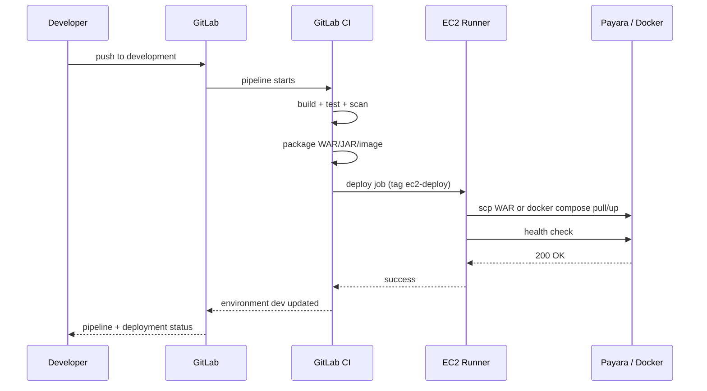
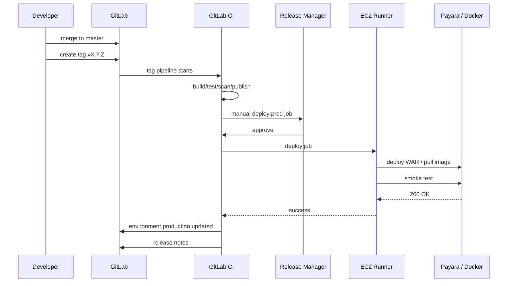

# EC2, GitLab Runner, and Docker Deployment Guide

**Audience:** DevOps and server owners  
**Goal:** set up a self-hosted GitLab Runner on EC2, deploy Dockerized services, and auto-deploy the `development` branch safely

---

## 1. Target layout

```
                         Internet
                            |
                    +-------v--------+
                    |  Nginx / ALB   |
                    |  80 / 443      |
                    +---+--------+---+
                        |        |
          +-------------v--+  +--v----------------+
          | Payara host    |  | EC2 app host      |
          | :8080 apps     |  | Docker Compose    |
          | :4848 admin    |  | :8081, :8082,     |
          | (private only) |  | :3000 (loopback)  |
          +----------------+  +-------------------+
                        ^              ^
                        | SSH + asadmin| SSH + docker compose
                        |              |
                    +---+--------------+---+
                    | GitLab Runner on EC2 |
                    | docker executor      |
                    | tags: ec2-deploy     |
                    +----------------------+
                              ^
                              | HTTPS
                        GitLab.com
```

Two viable layouts:

**A. Dedicated runner (recommended)**

- A small EC2 instance runs only the GitLab Runner.
- It can reach the Payara host and app host over SSH.
- Build jobs use GitLab.com shared runners (no AWS credentials).
- Deploy jobs use the self-hosted runner with protected variables.

**B. Runner on the app host**

- Cheaper, but the runner and production workloads share a host.
- If you choose this, run the runner on the **dev** host, not production.
- Isolate the runner with a dedicated OS user and Docker network.

---

## 2. Amazon Linux 2023 base setup

Run on the runner instance:

```bash
sudo dnf update -y
sudo dnf install -y docker git curl jq unzip openssh-clients
sudo systemctl enable --now docker
sudo usermod -aG docker ec2-user
```

Log out and back in for the group change, then verify:

```bash
docker version
docker compose version
```

### 2.1 Install Docker Compose v2

```bash
sudo mkdir -p /usr/libexec/docker/cli-plugins
sudo curl -SL "https://github.com/docker/compose/releases/latest/download/docker-compose-linux-x86_64" \
  -o /usr/local/lib/docker/cli-plugins/docker-compose
sudo chmod +x /usr/local/lib/docker/cli-plugins/docker-compose
docker compose version
```

### 2.2 Install GitLab Runner

```bash
curl -L "https://packages.gitlab.com/install/repositories/runner/gitlab-runner/script.rpm.sh" | sudo bash
sudo dnf install -y gitlab-runner
sudo systemctl enable --now gitlab-runner
```

### 2.3 Register the runner

1. In GitLab, open the group or project.
2. Go to **Settings -> CI/CD -> Runners**.
3. Create a new project/group runner.
4. Copy the runner authentication token.
5. Register on the EC2 instance:

```bash
sudo gitlab-runner register \
  --non-interactive \
  --url "https://gitlab.com/" \
  --token "<RUNNER_AUTHENTICATION_TOKEN>" \
  --executor "docker" \
  --docker-image "alpine:3.20" \
  --description "ec2-docker-runner" \
  --tag-list "ec2-docker,ec2-deploy" \
  --docker-privileged
```

**About `--docker-privileged`:** the provided Spring Boot and Node templates use Docker-in-Docker (DinD) to build images. DinD requires a privileged runner. Run it only on a dedicated runner instance, never on a shared runner, and never on the production Payara host.

If privileged runners are not allowed, use **Kaniko** or **Buildah** instead of DinD. The rest of the pipeline (test, publish, deploy) stays the same.

### 2.4 Runner configuration

The register command creates `/etc/gitlab-runner/config.toml`. Verify:

```toml
concurrent = 4
check_interval = 0

[[runners]]
  name = "ec2-docker-runner"
  url = "https://gitlab.com/"
  token = "..."
  executor = "docker"
  [runners.docker]
    image = "alpine:3.20"
    privileged = true
    volumes = ["/cache"]
```

Restart after changes:

```bash
sudo gitlab-runner restart
sudo gitlab-runner verify
```

### 2.5 Runner security rules

- Do not store production secrets in unprotected variables. Use **protected** variables so only protected branches/tags can read them.
- Do not allow fork merge requests to run deploy jobs.
- Use `resource_group` in deploy jobs to prevent two deployments from running at the same time.
- Patch the runner monthly.
- Restrict the runner's security group to GitLab.com and the target hosts.
- Give the runner's IAM role only the permissions it needs (ideally none if you use GitLab registries).

---

## 3. Prepare the deploy user and SSH keys

### 3.1 On the runner

Generate a dedicated key pair:

```bash
ssh-keygen -t ed25519 -C "gitlab-ci-deploy" -f ~/.ssh/kyc_deploy -N ""
cat ~/.ssh/kyc_deploy.pub
```

Store the **private** key in GitLab:

- Scope: group or project
- Key: `PAYARA_SSH_PRIVATE_KEY` (or `EC2_SSH_PRIVATE_KEY`)
- Type: **File** or **Variable** (the templates expect a variable containing the key text)
- Protected: yes
- Masked: only if the value meets GitLab's masking rules; otherwise leave masked off and rely on protected scope

Never commit the private key.

### 3.2 On the Payara host and app host

Create a `deploy` user and add the public key:

```bash
sudo useradd --create-home --shell /bin/bash deploy
sudo mkdir -p /home/deploy/.ssh
sudo chmod 700 /home/deploy/.ssh
sudo sh -c 'cat >> /home/deploy/.ssh/authorized_keys' <<'EOF'
ssh-ed25519 AAAA... gitlab-ci-deploy
EOF
sudo chmod 600 /home/deploy/.ssh/authorized_keys
sudo chown -R deploy:deploy /home/deploy/.ssh
```

Test from the runner:

```bash
ssh -i ~/.ssh/kyc_deploy deploy@<payara-host> "hostname"
ssh -i ~/.ssh/kyc_deploy deploy@<app-host> "docker --version"
```

### 3.3 SSH host keys

Add the target host keys to the runner's `known_hosts`:

```bash
ssh-keyscan -H <payara-host> >> ~/.ssh/known_hosts
ssh-keyscan -H <app-host> >> ~/.ssh/known_hosts
```

The CI templates also run `ssh-keyscan` in the job. For higher assurance, pin the host keys in a file-type CI variable instead of trusting the network.

---

## 4. Directory layout on the app host

```bash
sudo mkdir -p /opt/svi/{auth-service,kyc-api,digicash}
sudo mkdir -p /opt/svi/auth-service/config
sudo chown -R deploy:deploy /opt/svi
```

Recommended layout per app:

```
/opt/svi/<app>/
  docker-compose.yml
  .env                 # image tag and non-secret settings
  app.env              # runtime secrets/config, mode 600
  config/              # Spring Boot external config, mode 600
  backups/             # previous image tags / env files
```

For Spring Boot, mount `config/` into the container and set:

```env
SPRING_CONFIG_ADDITIONAL_LOCATION=file:/config/
DB_CONFIG_FILE=/config/DBConfig.properties
GENERAL_CONFIG_FILE=/config/GeneralConfig.properties
KEYCLOAK_GENERIC_CONFIG_FILE=/config/KeycloakGenericConfig.properties
KEYCLOAK_ADMIN_CONFIG_FILE=/config/KeycloakAdminConfig.properties
KEYCLOAK_ENDPOINTS_CONFIG_FILE=/config/KeycloakEndpointsConfig.properties
EMAIL_SENDER_CONFIG_FILE=/config/EmailSenderConfig.properties
KYC_API_CONFIG_FILE=/config/KYCAPIConfig.properties
OIDC_CONFIG_FILE=/config/OIDCConfig.properties
INIT_CONFIG_FILE=/config/InitConfig.properties
```

This replaces the hardcoded `/home/auth_system/auth_ws/config/config_files_properties/...` path and makes the container portable.

---

## 5. Secrets on the server

Preferred order:

1. **AWS Systems Manager Parameter Store / Secrets Manager** with an EC2 instance profile.
2. **GitLab protected CI/CD variables** rendered to `app.env` at deploy time.
3. Hand-edited `app.env` with `600` permissions (last resort).

### 5.1 Fetch from SSM at deploy time

```bash
aws ssm get-parameters-by-path \
  --path "/kyc/dev/auth-service" \
  --with-decryption \
  --recursive \
  --query "Parameters[*].[Name,Value]" \
  --output text
```

Use an instance profile. Do not create static AWS access keys for the EC2 instance.

### 5.2 Render `app.env` in CI

If you must render from CI variables:

```bash
umask 077
ssh deploy@<app-host> "cat > /opt/svi/auth-service/app.env" <<EOF
DB_PASSWORD=${DB_PASSWORD}
KEYCLOAK_CLIENT_SECRET=${KEYCLOAK_CLIENT_SECRET}
EOF
ssh deploy@<app-host> "chmod 600 /opt/svi/auth-service/app.env"
```

Avoid `echo`/`printf` with secrets in job logs. GitLab masks known variable values, but do not rely on masking alone.

### 5.3 Docker registry login

On the app host, use a **read-only deploy token**:

```bash
echo "<DEPLOY_TOKEN>" | docker login registry.gitlab.com \
  --username "<DEPLOY_TOKEN_USER>" \
  --password-stdin
```

The token needs only `read_registry`. Store it in `/home/deploy/.docker/config.json` with `600` permissions, or in SSM and log in during deploy.

Do not use your personal GitLab password. Do not pass tokens on the command line where `ps` can see them.

---

## 6. Docker Compose deployment pattern

### 6.1 Compose file

Use `templates/docker-compose.app.yml` as a starting point. It expects:

- `APP_IMAGE` - full registry image with tag
- `APP_NAME`
- `APP_PORT` - loopback port for Nginx and the container port
- `APP_ENV_FILE` - runtime config file (defaults to `$APP_DIR/app.env` in the deploy script)
- `HEALTH_PATH` - container-local health path

Key points:

- Bind to `127.0.0.1`, not `0.0.0.0`, so the container is not exposed directly.
- `restart: unless-stopped`
- `healthcheck` using `wget`/`curl`
- log rotation
- `pull_policy: always` when deploying from a registry

### 6.2 First manual deploy

```bash
cd /opt/svi/auth-service
docker login registry.gitlab.com --username <user> --password-stdin <<< "<token>"
docker compose pull
docker compose up -d
docker compose ps
curl -fsS http://127.0.0.1:8081/actuator/health
```

### 6.3 Update deploy

The CI job should:

1. Export `APP_IMAGE`, `APP_NAME`, `APP_PORT`, `HEALTH_PATH`.
2. `docker compose pull app`.
3. `docker compose up -d --remove-orphans`.
4. Wait for the container health check or the HTTP health URL.
5. On failure, redeploy the image that was running before the change.

Use `scripts/deploy-compose.sh`; the CI deploy jobs call it over SSH.

### 6.4 Systemd alternative (no Docker)

If a Spring Boot service must run directly on the host:

```ini
[Unit]
Description=SVI Auth Service
After=network-online.target
Wants=network-online.target

[Service]
Type=simple
User=app
Group=app
WorkingDirectory=/opt/svi/auth-service
EnvironmentFile=/opt/svi/auth-service/app.env
ExecStart=/usr/bin/java -XX:MaxRAMPercentage=75 -XX:+ExitOnOutOfMemoryError -jar /opt/svi/auth-service/app.jar
Restart=always
RestartSec=10
SuccessExitStatus=143
LimitNOFILE=65536

[Install]
WantedBy=multi-user.target
```

Install and start:

```bash
sudo cp auth-service.service /etc/systemd/system/
sudo systemctl daemon-reload
sudo systemctl enable --now auth-service
sudo systemctl status auth-service
journalctl -u auth-service -f
```

Docker is preferred because the artifact is identical to what CI tested.

---

## 7. Nginx reverse proxy

Example for the dev host:

```nginx
upstream auth_sb {
    server 127.0.0.1:8081;
    keepalive 32;
}

upstream kyc_sb {
    server 127.0.0.1:8082;
    keepalive 32;
}

upstream payara_http {
    server 127.0.0.1:8080;
    keepalive 32;
}

server {
    listen 80;
    server_name kyc.dev.svi.cloud;
    return 301 https://$host$request_uri;
}

server {
    listen 443 ssl http2;
    server_name kyc.dev.svi.cloud;

    ssl_certificate     /etc/letsencrypt/live/kyc.dev.svi.cloud/fullchain.pem;
    ssl_certificate_key /etc/letsencrypt/live/kyc.dev.svi.cloud/privkey.pem;

    client_max_body_size 25m;

    # Spring Boot auth service (context path is /spring/auth-services)
    location /spring/auth-services/ {
        proxy_pass http://auth_sb;
        proxy_http_version 1.1;
        proxy_set_header Host $host;
        proxy_set_header X-Real-IP $remote_addr;
        proxy_set_header X-Forwarded-For $proxy_add_x_forwarded_for;
        proxy_set_header X-Forwarded-Proto $scheme;
    }

    # Spring Boot KYC API (context path is /gen-kyc-api-sb)
    location /spring/gen-kyc-api/ {
        proxy_pass http://kyc_sb/gen-kyc-api-sb/;
        proxy_http_version 1.1;
        proxy_set_header Host $host;
        proxy_set_header X-Real-IP $remote_addr;
        proxy_set_header X-Forwarded-For $proxy_add_x_forwarded_for;
        proxy_set_header X-Forwarded-Proto $scheme;
    }

    # Payara applications
    location /portal/ {
        proxy_pass http://payara_http;
        proxy_http_version 1.1;
        proxy_set_header Host $host;
        proxy_set_header X-Real-IP $remote_addr;
        proxy_set_header X-Forwarded-For $proxy_add_x_forwarded_for;
        proxy_set_header X-Forwarded-Proto $scheme;
    }

    location /auth-services/ {
        proxy_pass http://payara_http;
        proxy_http_version 1.1;
        proxy_set_header Host $host;
        proxy_set_header X-Real-IP $remote_addr;
        proxy_set_header X-Forwarded-For $proxy_add_x_forwarded_for;
        proxy_set_header X-Forwarded-Proto $scheme;
    }

    location /gen-kyc-api/ {
        proxy_pass http://payara_http;
        proxy_http_version 1.1;
        proxy_set_header Host $host;
        proxy_set_header X-Real-IP $remote_addr;
        proxy_set_header X-Forwarded-For $proxy_add_x_forwarded_for;
        proxy_set_header X-Forwarded-Proto $scheme;
    }

    location /viewer/ {
        proxy_pass http://payara_http;
        proxy_http_version 1.1;
        proxy_set_header Host $host;
        proxy_set_header X-Real-IP $remote_addr;
        proxy_set_header X-Forwarded-For $proxy_add_x_forwarded_for;
        proxy_set_header X-Forwarded-Proto $scheme;
    }
}
```

Notes:

- `proxy_pass http://auth_sb;` without a URI preserves the original path, which matches the Spring Boot context path.
- For `/spring/gen-kyc-api/`, the Spring Boot context path is `/gen-kyc-api-sb`, so the proxy rewrites the prefix. Confirm the mapping with the app owner.
- Keep `4848`, `8081`, `8082`, `3000`, and `8080` private. Only `80`/`443` should be public.
- Use `certbot --nginx` for Let's Encrypt certificates:

```bash
sudo dnf install -y certbot python3-certbot-nginx
sudo certbot --nginx -d kyc.dev.svi.cloud
sudo certbot renew --dry-run
```

---

## 8. Auto-deploy on push

### 8.1 Dev flow



### 8.2 Production flow



### 8.3 Concurrency guard

Add to every deploy job:

```yaml
resource_group: "deploy-$CI_ENVIRONMENT_NAME-$CI_PROJECT_NAME"
```

This prevents two pipelines from deploying to the same environment at the same time.

---

## 9. Health checks

### 9.1 HTTP check

```bash
curl -fsS --max-time 5 "https://kyc.dev.svi.cloud/portal/" >/dev/null
```

Accept:

- `200-399`
- `401` / `403` for protected apps
- Retry for up to 60 seconds after deploy

Use `scripts/smoke-test.sh`.

### 9.2 Spring Boot Actuator

Add the dependency:

```xml
<dependency>
  <groupId>org.springframework.boot</groupId>
  <artifactId>spring-boot-starter-actuator</artifactId>
</dependency>
```

Expose only health/info/metrics:

```properties
management.endpoints.web.exposure.include=health,info,metrics,prometheus
management.endpoint.health.show-details=when-authorized
```

If the app is behind a context path, the health URL is:

```
http://127.0.0.1:8081/spring/auth-services/actuator/health
```

### 9.3 Payara

There is no standard health endpoint. Use the context root and accept 200/302/401/403. For APIs, add a lightweight `/health` endpoint if possible.

### 9.4 DigiCash

`/api/health` already exists and is used by the Docker health check. Keep it.

---

## 10. Rollback

### 10.1 Docker

`scripts/deploy-compose.sh` reads the current container image before recreating the service, records the deployed image in `.deployed-image`, and automatically rolls back to the previous image when the health check fails. Manual rollback:

```bash
APP_IMAGE=registry.gitlab.com/<group>/<project>/<app>:<previous-tag> \
APP_NAME=auth-service APP_PORT=8081 \
APP_ENV_FILE=/opt/svi/auth-service/app.env \
HEALTH_PATH=/spring/auth-services/actuator/health \
/usr/local/bin/deploy-compose /opt/svi/auth-service
```

The CI rollback job does the same thing with the `ROLLBACK_IMAGE` variable.

### 10.2 Payara

`scripts/deploy-payara.sh` keeps the previous WAR and re-deploys it if the health check fails. Manual rollback:

```bash
sudo -u payara /usr/local/bin/payara-deploy <app> <previous-war> <context-root>
```

### 10.3 Vercel

Use the Vercel dashboard to promote the previous deployment, or run:

```bash
vercel rollback <deployment-url> --token "$VERCEL_TOKEN"
```

### 10.4 Database

Do not auto-rollback database migrations. Design them to be backward-compatible and keep a tested restore procedure. Document the DB rollback separately for each service.

---

## 11. Firewall and security groups

| Port | Source | Purpose |
|---|---|---|
| `22` | Runner / admin IPs only | SSH deploy |
| `80` | `0.0.0.0/0` | HTTP redirect |
| `443` | `0.0.0.0/0` | HTTPS |
| `4848` | Runner / admin IPs only | Payara admin (prefer private) |
| `8080` | App host / Nginx only | Payara HTTP |
| `8081` | App host / Nginx only | Spring Boot auth |
| `8082` | App host / Nginx only | Spring Boot KYC API |
| `3000` | App host / Nginx only | DigiCash |

Do not expose Payara admin, Spring Boot ports, or the Docker API to the internet.

---

## 12. Hardening checklist

- [ ] SSH password authentication disabled; key-only access.
- [ ] Root login disabled.
- [ ] `deploy` user has no sudo shell; only the deploy script via sudoers.
- [ ] Payara admin port restricted to the runner/VPN.
- [ ] Payara password file `600`, owned by the Payara user.
- [ ] Docker registry token is read-only and stored with `600`.
- [ ] `app.env` and `config/` are `600`/`640`, owned by the deploy user.
- [ ] CloudWatch agent installed; logs shipped.
- [ ] Disk, CPU, memory, and container restart alarms configured.
- [ ] Unattended security updates enabled or a monthly patch window scheduled.
- [ ] Runner token rotated if exposed.
- [ ] Backups tested (Payara domain, app config, database).
- [ ] No secrets in git, CI YAML, Dockerfiles, or frontend builds.

---

## 13. Minimal rollout order

1. Create the runner and register it with tags `ec2-docker` and `ec2-deploy`.
2. Create the `deploy` user and SSH key on the target hosts.
3. Install `payara-deploy` and `deploy-compose.sh` on the hosts.
4. Add GitLab variables:
   - `PAYARA_HOST`, `PAYARA_SSH_USER`, `PAYARA_SSH_PRIVATE_KEY`
   - `EC2_HOST`, `EC2_USER`, `EC2_SSH_PRIVATE_KEY`
   - `EC2_APP_DIR`
   - `PAYARA_ADMIN_PORT`, `PAYARA_HTTP_PORT` (the `asadmin` and password-file paths live on the server, not in CI)
   - `DEV_CONTEXT_ROOT`, `PROD_CONTEXT_ROOT`, `APP_NAME`, `DEV_BASE_URL`, `PROD_BASE_URL`
5. Run the Payara deploy manually from a feature branch first.
6. Add `deploy:dev` for `development`.
7. Add `deploy:prod` for tags with a manual gate.
8. Test rollback in dev.
9. Document the runbook in the repo README.
