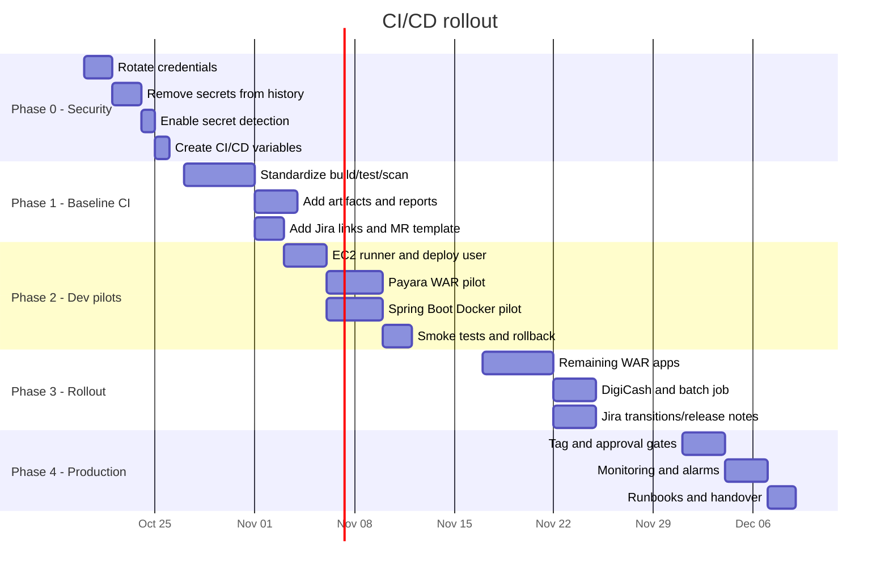

# CI/CD Implementation Roadmap

**Goal:** move from manual, inconsistent deployments to a repeatable GitLab CI/CD flow in about eight weeks without destabilizing the KYC platform

---

## 1. Guiding principles

1. **Security before automation.** Rotate exposed credentials first; automating a leak makes it worse.
2. **Pilot small.** Prove the deploy/rollback loop on one Payara WAR and one Spring Boot service.
3. **One path per artifact type.** Do not invent a new deployment method for every repo.
4. **Build once, deploy the same artifact.** Do not rebuild on the server.
5. **Every deployment is traceable.** Version + commit SHA + pipeline URL + operator.
6. **Every deployment is reversible.** Keep the previous artifact and test rollback.
7. **Dev is automatic; production is deliberate.** Auto-deploy the integration branch, gate production with an approval.
8. **Standards start on day one.** Jira-linked branches and commits are cheap now and expensive later.

---

## 2. Timeline

Dates are illustrative. Adjust to sprint boundaries and team availability.

---

## 3. Phase 0 - Security cleanup

**Duration:** 2-4 days  
**Owner:** DevOps lead + security owner  
**Goal:** remove the ability for a pipeline to leak credentials and make the current exposures harmless.

### Tasks

- [ ] Inventory every credential found in repositories, CI YAML, docs, and server files.
- [ ] Rotate AWS access keys used by the legacy pipelines.
- [ ] Rotate Payara admin credentials if they were stored anywhere in git.
- [ ] Rotate Keycloak client secrets, database passwords, and DigiCash keys found in tracked config files.
- [ ] Remove secrets from the files and commit placeholders.
- [ ] Rewrite git history to remove the values (coordinate a clone freeze; keep a backup mirror).
- [ ] Enable GitLab Secret Detection on all repos; run a historic scan once.
- [ ] Create masked + protected CI/CD variables for the new credentials.
- [ ] Move runtime secrets to AWS Secrets Manager/SSM or protected variables.
- [ ] Confirm no secret is printed in CI logs.
- [ ] Add a pre-commit hook or `git-secrets` rule for local development.

### Acceptance criteria

- [ ] A fresh clone contains no live credential.
- [ ] Historic secret scan is clean or all remaining hits are documented false positives/placeholders.
- [ ] Old credentials are revoked, not just removed from the repo.
- [ ] CI deploy jobs can read the new variables only on protected branches/tags.

### Risks

| Risk | Mitigation |
|---|---|
| Rotation breaks a running app | Update consumers first; keep the old credential valid until the new one is verified; use a maintenance window |
| History rewrite disrupts clones | Announce a freeze; provide a re-clone guide; keep a backup mirror |
| A secret is missed | Use multiple scanners (GitLab, `gitleaks`, manual grep for known patterns) |

---

## 4. Phase 1 - Baseline CI for every primary repo

**Duration:** 1-2 weeks  
**Owner:** DevOps + repo owners  
**Goal:** every primary repo has a pipeline that builds, tests, scans, and publishes an artifact on MRs, `development`, and tags.

### Tasks

- [ ] Replace the legacy `.gitlab-ci.yml` files with the Maven WAR template.
- [ ] Update the Spring Boot pipelines to run tests (`mvn verify`, no `-DskipTests`).
- [ ] Add a test job to the React WAR pipelines.
- [ ] Add pipelines for Person Viewer, Transaction Viewer, Generic OWA, DigiCash, and the batch tool.
- [ ] Add lint/typecheck jobs where scripts exist; add scripts where they are missing.
- [ ] Publish JUnit/coverage reports.
- [ ] Add Secret Detection, SAST, and dependency scanning.
- [ ] Add build caching for Maven and npm.
- [ ] Add artifact naming with version + short SHA.
- [ ] Add a `validate` job for tag format and Jira key in MR title.
- [ ] Add the MR template and update the README with build/test commands.

### Acceptance criteria

- [ ] Every primary repo shows a green MR pipeline.
- [ ] Tests run on every MR and block merge on failure.
- [ ] A WAR/JAR/image artifact is downloadable from the pipeline.
- [ ] Build time is under 10 minutes for the normal path.
- [ ] Security scans produce a report; critical/high findings block merge.
- [ ] The legacy tag-to-S3 jobs are retired or converted to the new flow.

### Notes

- Do not try to reach 100% coverage. Focus on making the existing tests run reliably.
- If a test is flaky or depends on a live service, isolate it as an integration test and mark it appropriately. Do not skip the whole suite.
- Pin Docker image versions (or digests) to avoid surprise breakage.

---

## 5. Phase 2 - Dev auto-deploy pilots

**Duration:** 2-3 weeks  
**Owner:** DevOps + one Payara app owner + one Spring Boot owner  
**Goal:** prove the end-to-end flow on two apps with health checks and rollback.

### Pilot selection

**Payara pilot:** `svi-authenticationportal-react-kyc`  
Why: it already has a WAR build pipeline, a clear context root (`/portal`), and frontend deployment is low risk in dev.

**Spring Boot pilot:** `svi-authentication-springboot-kyc`  
Why: it has 51 test classes, a clean JAR, an explicit port (8081), and a clear context path. It is the best candidate to prove Docker deployment.

### Tasks

- [ ] Create the EC2 runner and register it with `ec2-docker,ec2-deploy` tags.
- [ ] Create the `deploy` user and SSH key on the Payara and app hosts.
- [ ] Install `payara-deploy` and `deploy-compose.sh` on the hosts.
- [ ] Configure GitLab variables and protected environments.
- [ ] Add the `deploy:dev` jobs with `resource_group`.
- [ ] Add a smoke-test job after deploy.
- [ ] Add the Spring Boot Dockerfile and Compose file.
- [ ] Add Actuator health check.
- [ ] Test a deliberate failure and verify rollback.
- [ ] Add a deployment record to the server log.
- [ ] Add a Slack/Teams/email notification.
- [ ] Document the runbook in each repo.

### Acceptance criteria

- [ ] Pushing to `development` deploys to dev without manual steps.
- [ ] A successful deploy is visible in GitLab environments.
- [ ] A broken WAR/image triggers an automatic rollback.
- [ ] Rollback time is under 5 minutes.
- [ ] The deployed version is visible in the app or in a version endpoint/log.
- [ ] No manual Payara console upload is needed for the pilot.

### Stop conditions

Pause the rollout if:

- The deploy job can delete or overwrite unrelated apps.
- The rollback fails in the test.
- Secrets appear in logs.
- Dev becomes unstable after auto-deploy.

---

## 6. Phase 3 - Roll out to the remaining apps

**Duration:** 2-3 weeks  
**Owner:** DevOps + repo owners  
**Goal:** all primary apps use the same pattern; Jira and release notes are connected.

### Tasks

- [ ] Add Payara deploy jobs to the legacy auth and KYC API WARs.
- [ ] Add deploy jobs to SSO Admin, Person Viewer, Transaction Viewer, and Generic OWA.
- [ ] Add the DigiCash Docker pipeline and switch Compose to pull from the registry.
- [ ] Add the batch JAR pipeline and systemd timer.
- [ ] Add Jira integration to each project.
- [ ] Add optional Jira transition on dev deploy success.
- [ ] Add release-note generation on tags.
- [ ] Add a rollback job to each deploy pipeline.
- [ ] Add a `CHANGELOG.md` or `docs/releases/` convention.
- [ ] Train the team on the new flow.

### Acceptance criteria

- [ ] All primary repos have build/test/scan/publish pipelines.
- [ ] All deployable apps have a dev deploy job and a rollback path.
- [ ] Jira issues link to commits and MRs.
- [ ] A release tag produces an immutable artifact and release notes.
- [ ] The team can explain the flow without referring to a specific person.

---

## 7. Phase 4 - Production gates, monitoring, and handover

**Duration:** 1-2 weeks  
**Owner:** DevOps + release manager  
**Goal:** make production deployments deliberate, observable, and recoverable.

### Tasks

- [ ] Protect `master` and `v*` tags.
- [ ] Create a protected `production` environment.
- [ ] Require manual approval for `deploy:prod`.
- [ ] Add a release checklist and change window.
- [ ] Add CloudWatch alarms and uptime checks.
- [ ] Add deployment markers to dashboards.
- [ ] Add log retention and access control.
- [ ] Test the production rollback procedure in a game day.
- [ ] Write the on-call runbook.
- [ ] Hand over ownership and schedule a monthly pipeline review.

### Acceptance criteria

- [ ] Production deploys require an approval and are recorded.
- [ ] Alerts fire on health check failure.
- [ ] Rollback is tested and documented.
- [ ] The team can restore the previous version without the original author.
- [ ] A monthly review checks pipeline duration, failures, and secret scan results.

---

## 8. Ownership matrix

| Area | Owner | Backup |
|---|---|---|
| GitLab CI templates and runner | DevOps lead | Senior engineer |
| Payara deployment script | DevOps + Payara app owner | Legacy Java lead |
| Spring Boot Docker images | Spring Boot service owners | DevOps |
| Frontend WAR builds | Frontend leads | DevOps |
| Jira integration and release notes | Project manager / Jira admin | DevOps |
| Security scans and secret rotation | Security owner | DevOps |
| Monitoring and alerts | DevOps | Service owners |
| Release approval | Release manager | Tech lead |

---

## 9. Communication plan

| Event | Audience | Channel | Timing |
|---|---|---|---|
| Kickoff and scope | All engineers, leads | Team meeting | Phase 0 start |
| Security cleanup freeze | All engineers | Email + chat | 2 days before history rewrite |
| Pipeline template available | All engineers | Chat + README | Phase 1 |
| Pilot demo | All engineers | Demo | End of Phase 2 |
| Standards training | All engineers | Workshop | Phase 3 |
| Production gate go-live | All engineers, release manager | Announcement | Phase 4 |
| Monthly pipeline review | DevOps, leads | Report | Monthly |

---

## 10. Risk register

| ID | Risk | Probability | Impact | Owner | Mitigation | Status |
|---|---|---|---|---|---|---|
| R1 | Credential rotation breaks an app | Medium | High | Security | Update consumers first; maintenance window; rollback secret | Open |
| R2 | History rewrite disrupts developers | Medium | Medium | DevOps | Freeze, re-clone guide, backup mirror | Open |
| R3 | Payara deploy causes downtime | High | Medium | DevOps | Low-traffic window; rollback; consider second node | Open |
| R4 | Tests are flaky in CI | High | Medium | Repo owners | Mock external services; Testcontainers; quarantine flaky tests | Open |
| R5 | Runner compromise | Low | High | DevOps | Dedicated runner; least privilege; patch monthly | Open |
| R6 | Team bypasses the pipeline | Medium | High | Leads | Protected branches; required MR; deploy only from CI | Open |
| R7 | Production config drift | Medium | High | DevOps | Config in SSM; deploy-time rendering; no manual edits | Open |
| R8 | Vercel/Convex ownership unclear | Low | Medium | Frontend lead | Document project owners and deploy keys | Open |
| R9 | Legacy app has no tests | High | Medium | Legacy lead | Add characterization tests; smoke tests; staged rollout | Open |
| R10 | Pipeline takes too long | Medium | Low | DevOps | Cache dependencies; parallel jobs; run heavy scans nightly | Open |

---

## 11. Decision log

Record decisions as they are made so future team members understand the "why".

| Date | Decision | Options considered | Owner | Rationale |
|---|---|---|---|---|
| 2026-10-19 | Use GitLab CI/CD | Jenkins, GitHub Actions, Codemagic | DevOps | Native to repos, built-in registry/scanners, lowest overhead |
| 2026-10-19 | Auto-deploy `development` to dev | Manual deploy, scheduled deploy | Leads | Fast feedback, low risk in dev |
| 2026-10-19 | Manual approval for production | Fully automatic, change advisory board | Leads | Compliance and blast-radius control |
| 2026-10-19 | WARs to Payara via SSH + asadmin | Admin Console, remote asadmin, REST | DevOps | Safer than exposing the admin port |
| 2026-10-19 | Spring Boot/Node via Docker Compose | systemd, Elastic Beanstalk, ECS | DevOps | Existing EC2/Docker practice, simple rollback |
| 2026-10-19 | GitLab Package/Container Registry | S3, Nexus, Docker Hub | DevOps | No extra credentials, integrated audit |
| 2026-10-19 | Jira keys in branch/commit/MR | Jira link only in MR description | PM + DevOps | End-to-end traceability |

---

## 12. First two weeks in detail

### Week 1

| Day | Task | Owner |
|---|---|---|
| 1 | Kickoff, confirm scope, freeze history rewrite window | DevOps lead |
| 1 | Inventory secrets and affected repos | Security |
| 2 | Rotate AWS, Payara, Keycloak, DB, DigiCash credentials | Security + owners |
| 2 | Remove secrets from working trees | Repo owners |
| 3 | Rewrite history and force-push protected branches with coordination | DevOps |
| 3 | Enable Secret Detection and historic scan | DevOps |
| 4 | Create GitLab variables and protected environments | DevOps |
| 4 | Create runner and register it | DevOps |
| 5 | Add baseline pipelines to two pilot repos | DevOps + owners |
| 5 | Confirm MR pipelines and artifacts | DevOps |

### Week 2

| Day | Task | Owner |
|---|---|---|
| 6 | Install deploy scripts and deploy user | DevOps |
| 6 | Test manual deploy script | DevOps + app owner |
| 7 | Add `deploy:dev` for the Payara pilot | DevOps |
| 7 | Add `deploy:dev` for the Spring Boot pilot | DevOps |
| 8 | Add smoke tests and rollback | DevOps |
| 8 | Deliberate failure test | DevOps + QA |
| 9 | Fix issues, add notifications | DevOps |
| 9 | Update README/runbooks | Repo owners |
| 10 | Demo and retrospective | All |

---

## 13. What "done" looks like

- A developer pushes a Jira-linked commit to `development`.
- GitLab runs the pipeline and deploys to dev automatically.
- The deployment is visible in GitLab and in the server log.
- A smoke test confirms the app is up.
- Jira is updated with the version and pipeline link.
- If the deploy fails, the previous version is restored automatically.
- A release tag produces an immutable artifact and release notes.
- Production deployment requires an approval and can be rolled back in minutes.
- No one needs to open the Payara Admin Console for a normal release.
